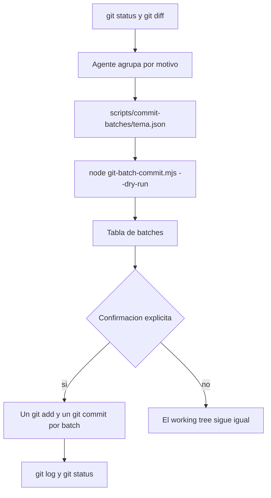

# How it works

`git-batch` separa dos trabajos que no conviene mezclar.

El agente decide el corte: qué archivos comparten un motivo y cómo se llama el commit. El script `skill/scripts/git-batch-commit.mjs` solo ejecuta ese plan. No interpreta el diff y no elige mensajes.

## Dónde corre

El script puede vivir fuera del repo, por ejemplo en `.cursor/skills/git-batch/scripts/`. No usa la carpeta del script como raíz.

1. `git rev-parse --show-toplevel` desde el directorio actual.
2. El JSON se busca primero desde el cwd y después desde esa raíz.
3. Cada path de un batch se resuelve así:
   - absoluto: se usa tal cual y tiene que caer dentro del repo
   - empieza por `./` o `../`: relativo al directorio del JSON, exista o no el archivo
   - cualquier otro: si existe junto al JSON se usa ese; si no, se usa desde la raíz del repo
4. Si el path resultante sale del repo, el run aborta.

Por eso un config de Katram con `../../src/app.ts` sigue funcionando, y un config nuevo puede decir `src/app.ts`.

Un archivo que no está en disco se stagea igual. `git add` de un path tracked que ya no existe registra el borrado. Para un borrado con ruta relativa al JSON, el prefijo `../` es obligatorio: sin el archivo en disco, la resolución no puede adivinar que `src/gone.ts` junto al JSON no era la intención.

## Qué hace cada batch

Para el batch N:

1. `insertLines`, si existe. Lee el archivo, busca la primera línea que contiene `insertAfter` o `insertBefore`, e inserta las líneas que todavía no están. `skipIfIncludes` anula la inserción completa cuando el texto ya está. El salto de línea original (`LF` o `CRLF`) se conserva.
2. `git add --` de los paths de `files` y de los archivos tocados por `insertLines`.
3. `git apply --cached` de cada `cachedPatches`. Eso mete un hunk en el index sin un `git add -p` interactivo. El working tree puede quedar distinto del commit; es el comportamiento de un stage parcial.
4. Si el index no tiene diff y `skipIfEmpty` no es `false`, el batch se salta. El default es saltar.
5. `git commit -m <subject> -m <body>`. La primera línea del `message` es el subject. El resto es el body.

`exclude` se aplica al stage, no solo como aviso. Un glob sin `*` también compara contra el basename, así que `.env` no entra aunque lo escribas como `config/.env`. `*` no cruza `/`. `**` sí.

Estos nombres se excluyen siempre, vengan o no en el JSON: `firebase-debug.log`, `firestore-debug.log`, `ui-debug.log`, `pubsub-debug.log`, `database-debug.log`.

Al final el script imprime cuántos commits se crearon, cuántos batches se saltaron, y el `git status --short` que haya quedado. Lo que no estaba en ningún batch sigue sin commitear. Ese es el punto: el resto del working tree no se arrastra.

## Dry-run

`--dry-run` no escribe archivos y no llama a `git add`, `git apply` ni `git commit`. Imprime la línea que habría corrido. Sí lee `git status` para avisar de archivos excluidos que están sucios.

Un dry-run correcto no deja el index a medias. Si un run real se corta a la mitad, los batches anteriores ya son commits y el batch fallido puede haber dejado paths en el index. Revisa `git status` antes de relanzar. `--from` y `--only` sirven para continuar sin repetir el principio. No se pueden usar juntos.

Los números son la posición en el array `batches`, empezando en 1. No son el `id`.

## Qué no hace

- No hace push, pull, rebase, amend ni `reset`.
- No parte un archivo en hunks salvo que tú pases un patch en `cachedPatches`.
- No formatea el código y no exige un changelog. Si el repo tiene esa convención, el agente la cumple al armar el JSON. `insertLines` existe para índices tipo changelog cuando el ancla es estable.
- No reescribe commits que ya están en la rama. Si el desorden ya se commiteó, el remedio es otro flujo, no este script.
- No adivina un plan si el JSON está mal. Falla con un error y sale con código 1.

## Por qué el agente no commitea solo

El skill le prohíbe la corrida real hasta un pedido explícito, sin `--dry-run`. El script no tiene red de seguridad más allá de eso: si lo invocas sin `--dry-run`, commitea. La confirmación es parte del uso, no un flag escondido.
